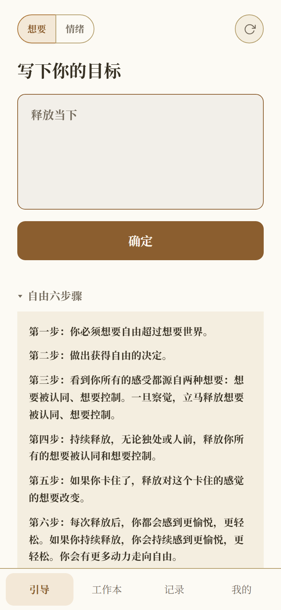
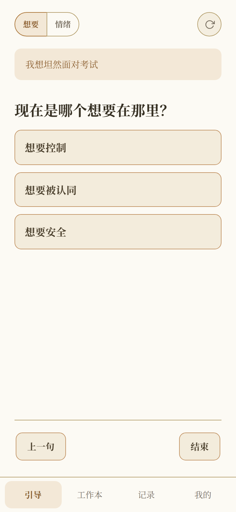
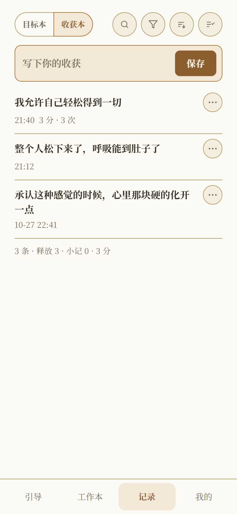
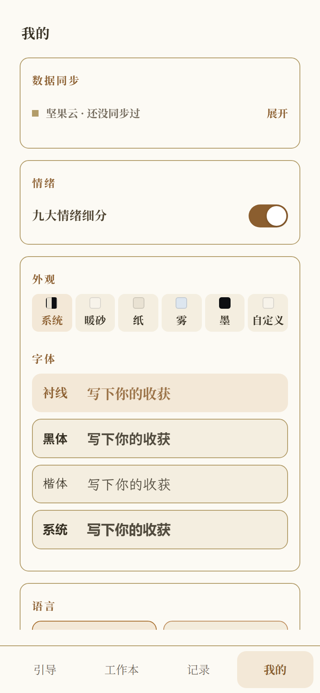
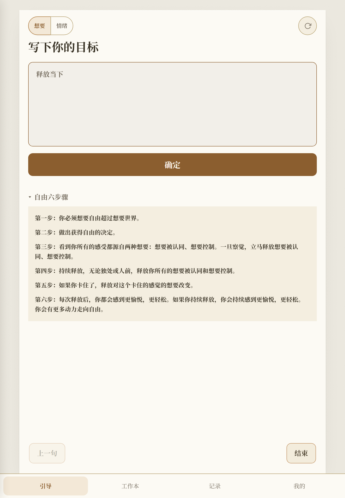
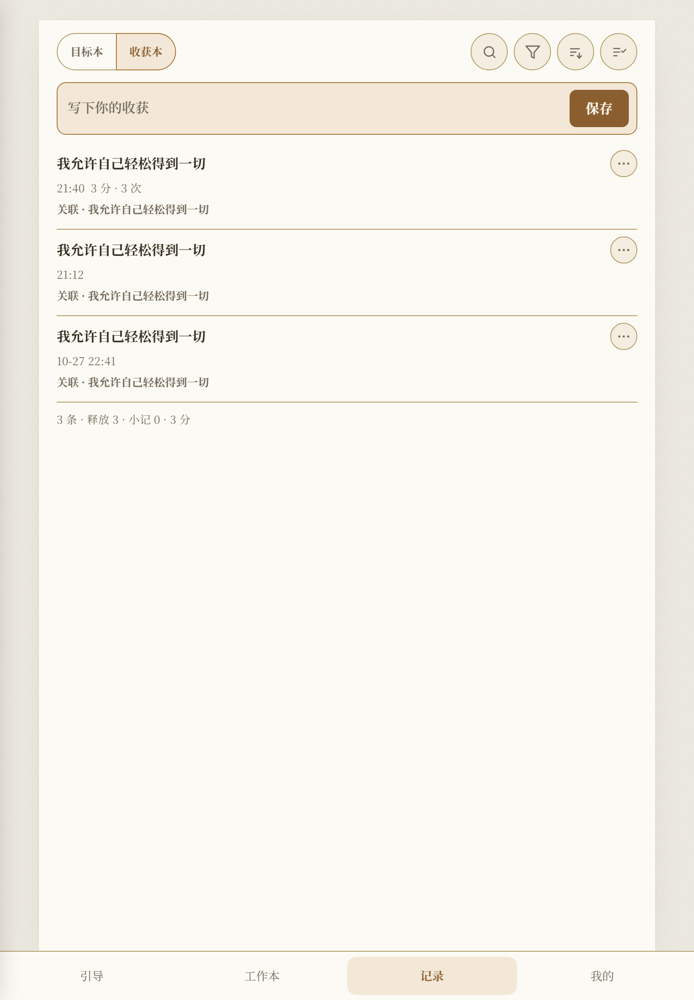
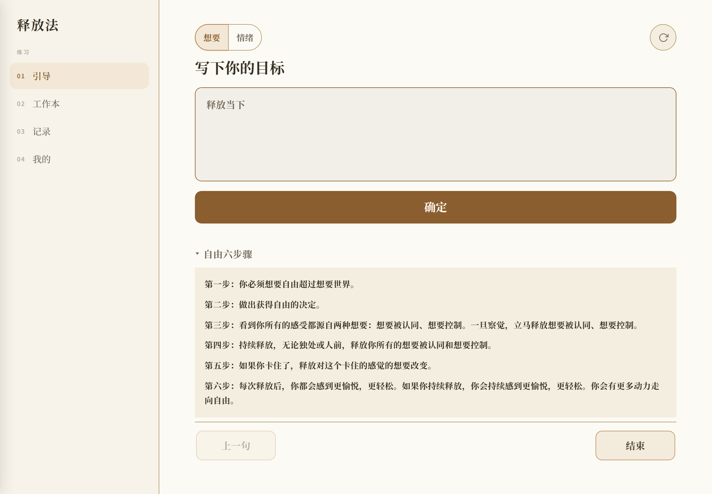
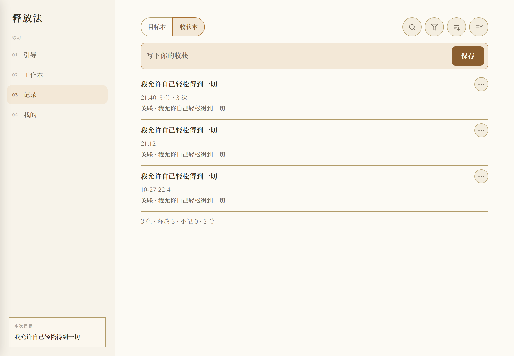
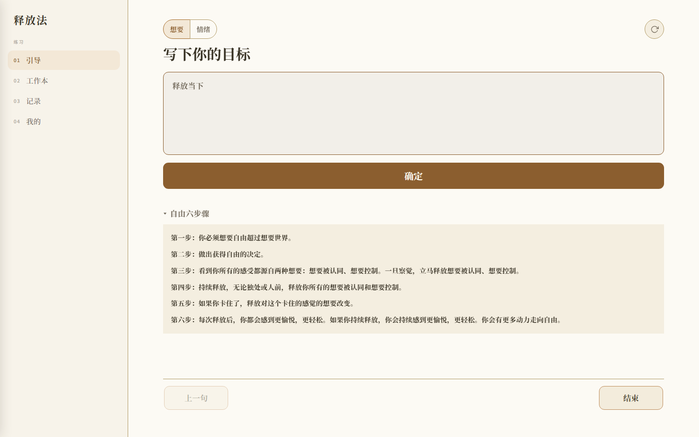

# 释放法 · 引导

免费的圣多纳释放法（Sedona Method）在线引导练习：打开就能练，无需注册，手机、平板、电脑浏览器都行。

## 在线使用（推荐）

**https://the-release.pages.dev**

手机（390×844 实拍）：

 

 

平板 · 竖屏（820×1180 实拍）：

 

平板 · 横屏（1180×820 实拍）：

电脑：

## 安卓安装包

- 打开网站 → 我的 → 找到我们 → 安卓版，直接下载（页面内校验字节数，失败自动转网盘）。
- 也可以到 [Releases](https://github.com/Venus521/sedona-release-method/releases) 下载。第一次安装要在系统设置里允许一次「未知来源」。
- 微信里下不了安装包：点右上角「···」→「在浏览器打开」，再用上面的方式下载。

iPhone 用 Safari 打开网站 → 我的 → 添加到主屏幕，就是全屏 App。

## 用法

进去有四个页签：

- **引导**：一句一句带你完成一次释放；
- **工作本**：八节课练习，自由模式随时进；
- **记录**：收获本、目标本两本分开记，支持批量勾选、批量删除、导出 TXT；
- **我的**：换主题和字体、配坚果云自动同步、下安装包。

## 数据

记录都存在本机浏览器里，清浏览器数据会连记录一起清。可以导出 TXT，也可以在「我的 → 数据同步」里配坚果云自动备份，换手机、清浏览器都不怕。

## 说明

问句来自圣多纳释放法（Sedona Method，Lester Levenson 创，Hale Dwoskin 整理推广），六步骤的中英文取自 1992 年练习本原文。

它不是医疗或心理治疗的替代品。情绪持续低落，请找专业帮助。

未经许可请勿改名再分发。
