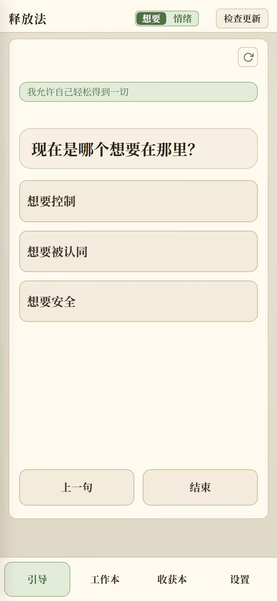
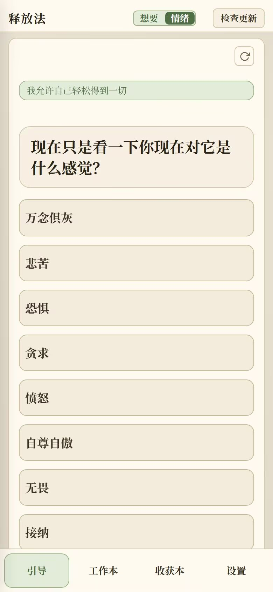
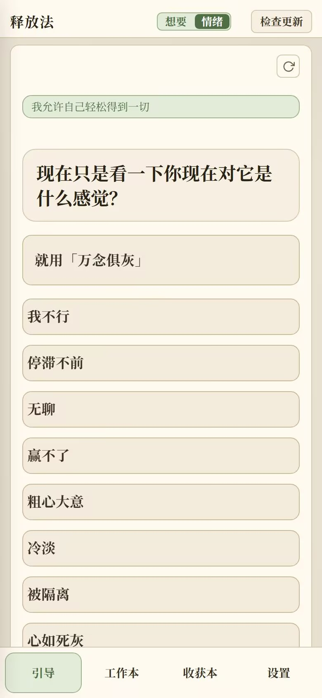
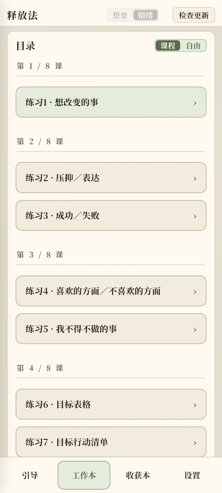
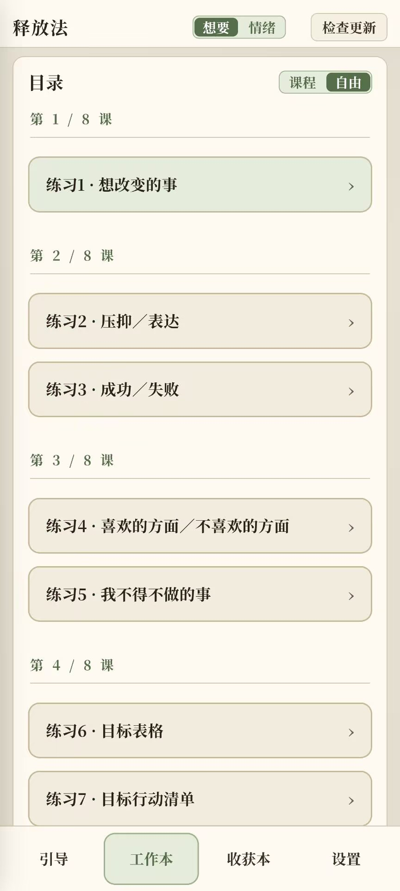
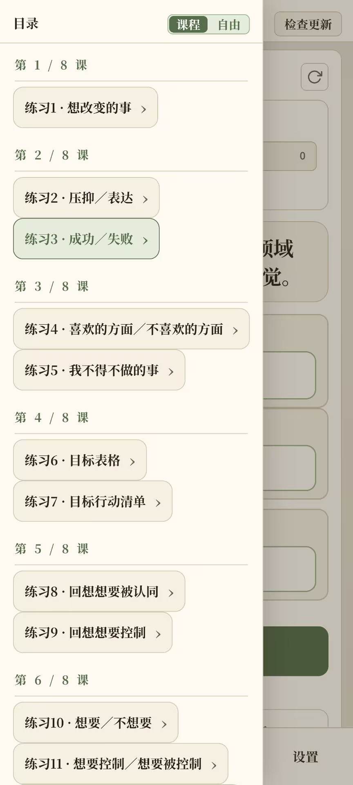
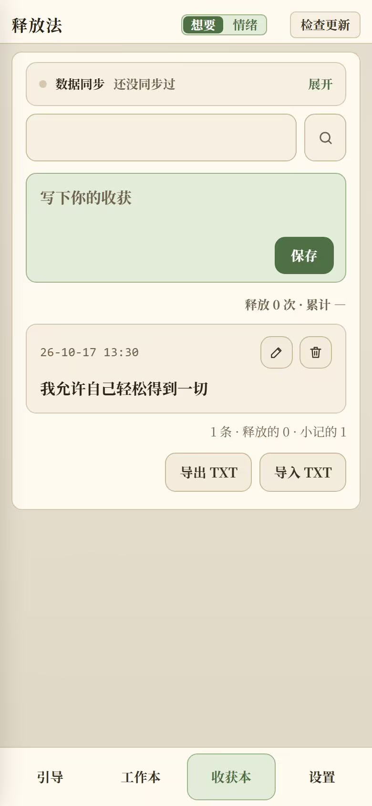
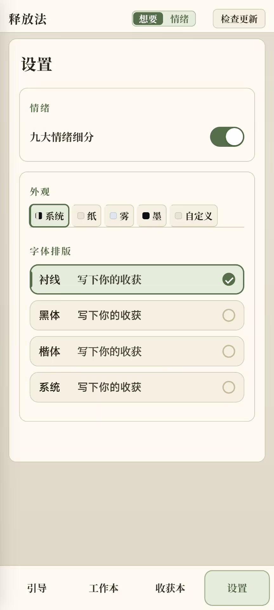

# 释放法 · 引导

## 在线使用（推荐，免安装）

打开 **https://the-release.pages.dev** 就能直接用：免费、无需注册，手机、平板、电脑浏览器都行。记录存在你自己手里，可导出 TXT，也能配坚果云自动同步。

手机：

 

 

平板：

电脑：

## 下载

到 [Releases](https://github.com/Venus521/sedona-release-method/releases) 下：

- 网页版：zip 解压后双击 `index.html`（或者直接把仓库里的 `index.html` 存下来）。
- 安卓版：`ShiFangFa-public.apk`，第一次装要在系统设置里允许一次「未知来源」。

## 用法

进去有四个页签：引导、八节课、工作本、收获本。引导，顶栏「外观」里能换配色和中英文。

## 数据

记录都存在本机浏览器里，清浏览器数据会连记录一起清掉。收获本有个导出 TXT，记得经常保存

## 说明

问句来自圣多纳释放法（Sedona Method，Lester Levenson 创，Hale Dwoskin 整理推广），六步骤的中英文取自 1992 年练习本原文。

它不是医疗或心理治疗的替代品。情绪持续低落，请找专业帮助。

未经许可请勿改名再分发。
